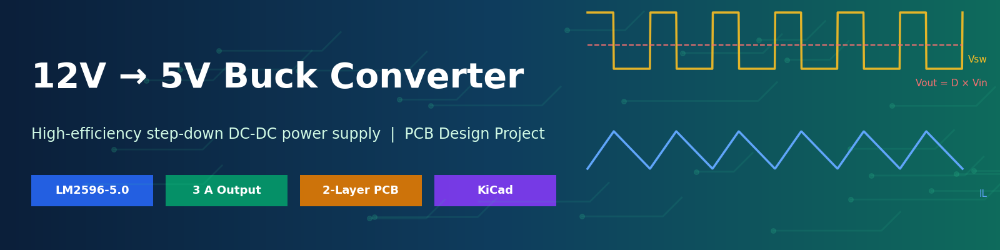
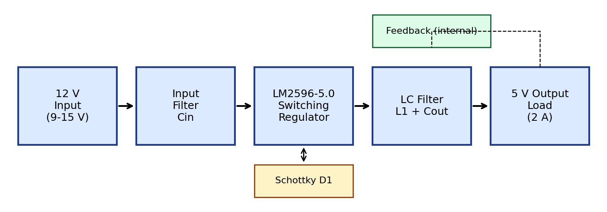
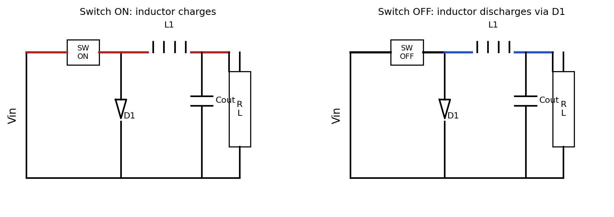
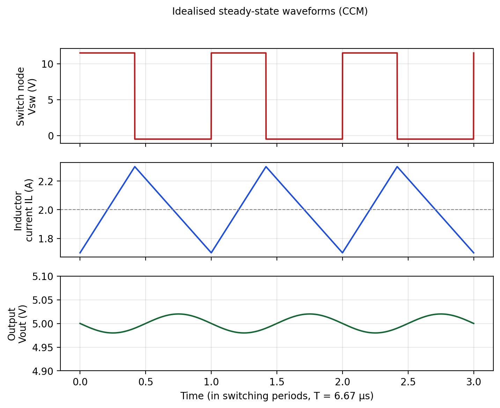
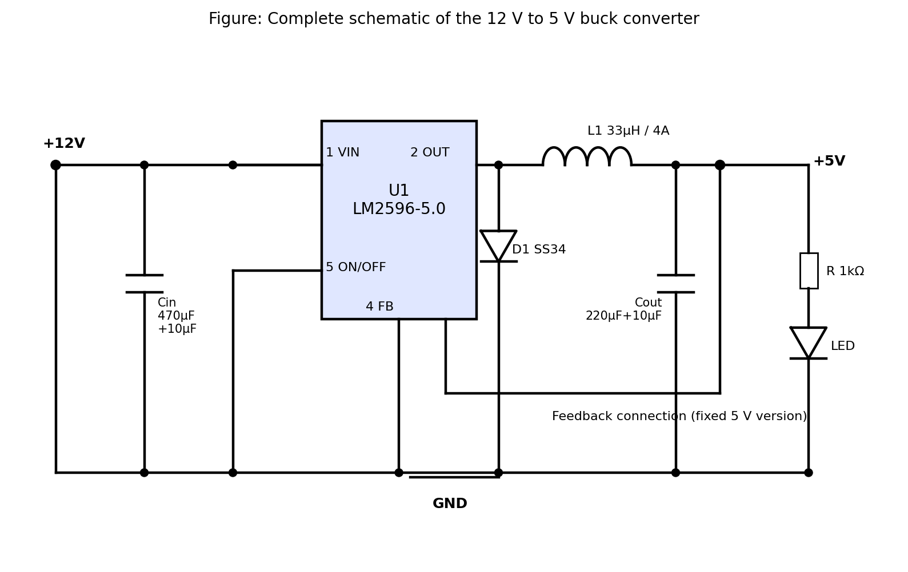
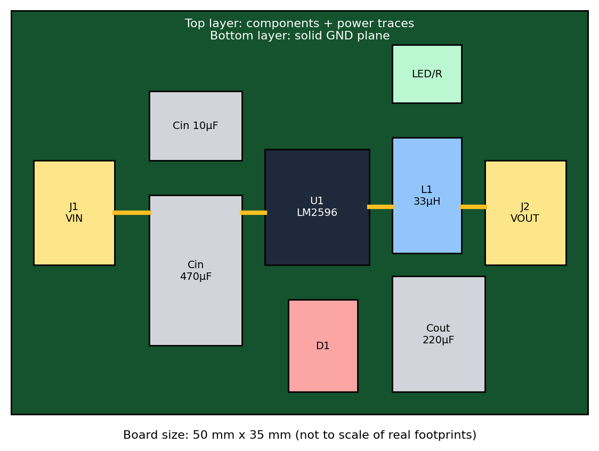
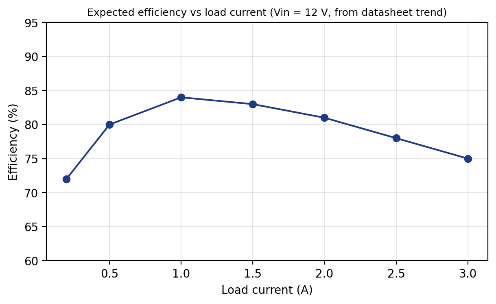

<div align="center">



# 12V to 5V Buck Converter

**A compact, high-efficiency step-down DC-DC converter built on the LM2596-5.0, with a complete 2-layer KiCad PCB design.**

[](LICENSE)
[](#license)
[](https://www.kicad.org/)
[](#specifications)
[](#specifications)
[](#results)
[](#contributing)

[Overview](#overview) •
[Features](#features) •
[Specifications](#specifications) •
[How It Works](#how-it-works) •
[Schematic](#schematic) •
[PCB](#pcb-design) •
[Getting Started](#getting-started) •
[Testing](#testing) •
[Results](#results) •
[Roadmap](#roadmap)

</div>

---

## Table of Contents

- [Overview](#overview)
- [Features](#features)
- [Specifications](#specifications)
- [How It Works](#how-it-works)
- [Design Calculations](#design-calculations)
- [Schematic](#schematic)
- [Bill of Materials](#bill-of-materials)
- [PCB Design](#pcb-design)
- [Repository Structure](#repository-structure)
- [Getting Started](#getting-started)
- [Assembly Guide](#assembly-guide)
- [Testing](#testing)
- [Results](#results)
- [Troubleshooting](#troubleshooting)
- [Applications](#applications)
- [Limitations](#limitations)
- [Roadmap](#roadmap)
- [Contributing](#contributing)
- [License](#license)
- [References](#references)
- [Author](#author)

---

## Overview

Most digital electronics run on 5 V, but common power sources such as batteries, adapters, and car supplies provide 12 V. A linear regulator like the 7805 can do the conversion, but it turns the extra 7 V into heat: at 2 A that is about 14 W wasted, and the efficiency is only around 42%.

This project replaces that approach with a **buck (step-down) switching converter**. The LM2596 chops the 12 V input at 150 kHz, and an inductor and capacitor smooth it into a clean 5 V output. The result is roughly **twice the efficiency**, about **one-sixth of the heat**, and no heat sink.

The repository contains the schematic, PCB layout, design calculations, bill of materials, test procedure, and a full project report.

> **Why this project?** It is a practical, buildable example of power-supply design: component selection, derating, thermal design, and the PCB layout practice that decides whether a switching supply works well or badly.

---

## Features

- Input range of **9 V to 15 V** (the IC itself accepts up to 40 V)
- Fixed **5 V output** at up to **3 A** (2 A continuous design point)
- **About 81% efficiency** at 2 A, compared with about 42% for a 7805
- **150 kHz** fixed switching frequency, which keeps the inductor and capacitors small
- Output ripple targeted below **50 mV peak-to-peak**
- Built-in **thermal shutdown** and **current limiting**
- Compact **50 mm x 35 mm** 2-layer board with a solid ground plane
- Power indicator LED
- Open hardware: all design files, calculations, and documentation included

---

## Specifications

| Parameter | Value |
|---|---|
| Input voltage | 12 V nominal (9 V to 15 V) |
| Output voltage | 5 V fixed |
| Output current | 2 A continuous, 3 A maximum |
| Switching frequency | 150 kHz |
| Regulator IC | LM2596S-5.0 (TO-263) |
| Topology | Asynchronous buck (Schottky freewheeling diode) |
| Inductor ripple | about 30% of load current (0.6 A) |
| Output ripple | below 50 mV peak-to-peak (target) |
| Efficiency | about 81% at 2 A, 12 V input (estimated) |
| PCB | 2-layer FR4, 1.6 mm, 1 oz copper, 50 x 35 mm |

---

## How It Works

The converter is built from a switch, an inductor, a diode, and an output capacitor.



Each 6.67 microsecond switching cycle has two phases:

| Phase | What happens |
|---|---|
| **Switch ON** | The input feeds the inductor. Its current ramps up and it stores energy. The diode is off. |
| **Switch OFF** | The inductor keeps pushing current through the Schottky diode to the load while its current ramps down. |



The output voltage is set by the duty cycle `D` (the fraction of each cycle the switch is on):

```
Vout = D x Vin        =>    D = 5 V / 12 V = 0.417
```

The LM2596 monitors the output through its feedback pin and adjusts `D` automatically, so the output stays at 5 V when the input or the load changes.



---

## Design Calculations

| Item | Formula | Result |
|---|---|---|
| Duty cycle | `D = Vout / Vin` | 0.417 (about 0.476 with diode and switch drops) |
| Inductor ripple | `dIL = 0.3 x Iout` | 0.6 A |
| Inductor | `L = (Vin - Vout) x D / (fsw x dIL)` | 32.4 uH, so **33 uH** (Isat of at least 4 A) |
| Output capacitor | ESR-limited ripple, `dIL x ESR` | **220 uF / 16 V low-ESR** + 10 uF ceramic |
| Input capacitor | `Icin(rms) = Iout x sqrt(D(1-D))` | about 1 A, so **470 uF / 25 V low-ESR** + 10 uF ceramic |
| Schottky diode | `Id(avg) = Iout x (1-D)` | 1.17 A average, so **3 A / 40 V** (SS34 or 1N5822) |
| Estimated loss | switch + switching + diode + inductor + ESR + quiescent | about 2.3 W |
| Efficiency | `Pout / (Pout + Ploss)` | about 81% |
| Junction temperature | `Ta + P(IC) x thetaJA` | about 70 C at 25 C ambient |

The full derivations are in [`docs/Project_Report.docx`](docs/Project_Report.docx).

---

## Schematic



**Connections**

- `J1` brings in 12 V, filtered by the 470 uF electrolytic and 10 uF ceramic input capacitors.
- `U1` (LM2596-5.0) pin 1 is VIN and pin 3 is GND. Pin 5 (ON/OFF) is grounded to keep the regulator always enabled.
- Pin 2 is the switch node, connected to the Schottky diode cathode and to inductor `L1`.
- The output of `L1` is the 5 V rail, filtered by the 220 uF and 10 uF capacitors and fed back to pin 4.
- A red LED with a 1 k resistor indicates that 5 V is present.

---

## Bill of Materials

| Ref | Component | Value / Part No. | Qty | Package |
|---|---|---|---|---|
| U1 | Buck regulator | LM2596S-5.0 | 1 | TO-263-5 |
| L1 | Power inductor | 33 uH, Isat of at least 4 A | 1 | Shielded SMD or radial |
| D1 | Schottky diode | SS34 or 1N5822 | 1 | SMC or DO-201 |
| C1 | Electrolytic capacitor | 470 uF, 25 V, low ESR | 1 | Radial 8 mm |
| C2 | Ceramic capacitor | 10 uF, 25 V, X7R | 1 | 1206 |
| C3 | Electrolytic capacitor | 220 uF, 16 V, low ESR | 1 | Radial 6.3 mm |
| C4 | Ceramic capacitor | 10 uF, 16 V, X7R | 1 | 1206 |
| R1 | Resistor | 1 k, 1% | 1 | 0805 |
| LED1 | Indicator LED | Red | 1 | 3 mm or 0805 |
| J1, J2 | Screw terminal | 2-pin, 5.08 mm pitch | 2 | Through-hole |
| PCB | FR4, 2-layer | 50 x 35 mm, 1.6 mm | 1 | - |

> **Component tips**
> - Use **low-ESR** electrolytics rated for 105 C. Ordinary ones cause high ripple and heating.
> - Pick the inductor by **saturation current**, not just its RMS rating.
> - Do **not** substitute a 1N4007 for the Schottky diode. It is too slow and drops too much voltage.

---

## PCB Design



| Parameter | Value |
|---|---|
| Layers | 2 (top: components and power, bottom: ground plane) |
| Board size | 50 mm x 35 mm |
| Power trace width | 1.5 mm minimum (2 to 3 mm where possible) |
| Clearance | 0.3 mm minimum (0.5 mm on 12 V nets) |
| Via | 0.8 mm pad / 0.4 mm drill |
| Finish | HASL (lead-free) or ENIG |

**Layout rules followed**

1. **Keep the hot loop small.** The input ceramic capacitor sits within 3 mm of the IC's VIN and GND pins.
2. **Keep the switch node small.** The node between U1, D1, and L1 swings from about -0.5 V to 12 V at 150 kHz and behaves like an antenna.
3. **Use a solid ground plane** on the bottom layer, with stitching vias next to every power-ground pad.
4. **Route feedback away from the inductor** and from the switch node.
5. **Use thermal copper.** The IC tab is soldered to a roughly 6 cm2 pour tied to the ground plane through 6 to 9 thermal vias.
6. **Separate input and output connectors** onto opposite edges of the board.

---

## Repository Structure

```
buck-converter-12v-5v/
├── README.md
├── LICENSE
├── assets/                    # Images used in this README
│   ├── banner.png
│   ├── block_diagram.png
│   ├── operating_modes.png
│   ├── waveforms.png
│   ├── schematic.png
│   ├── pcb_layout.png
│   └── efficiency_curve.png
├── docs/
│   └── Project_Report.docx    # Full project report
├── hardware/                  # (add your files here)
│   ├── kicad/                 # .kicad_pro, .kicad_sch, .kicad_pcb
│   ├── gerbers/               # Fabrication files (zip for upload)
│   └── bom/                   # BOM and pick-and-place files
└── test-data/                 # (add your files here) measurements, scope captures
```

---

## Getting Started

### Prerequisites

- [KiCad 8](https://www.kicad.org/download/) (or newer) to open or edit the design
- A soldering iron or hot-air station, and a multimeter
- A bench power supply (12 V, 3 A or more)
- An oscilloscope, if you want to check ripple

### Clone the repository

```bash
git clone https://github.com/<your-username>/buck-converter-12v-5v.git
cd buck-converter-12v-5v
```

### Open the design

1. Launch KiCad and open `hardware/kicad/buck_converter.kicad_pro`.
2. Open the schematic editor and run **Inspect > Electrical Rules Checker**.
3. Open the PCB editor and run **Inspect > Design Rules Checker**. It should report 0 errors.

### Order the PCB

1. In the PCB editor choose **File > Fabrication Outputs > Gerbers** and **Drill Files**.
2. Zip the outputs, or use the zip already in `hardware/gerbers/`.
3. Upload the zip to a fabricator such as JLCPCB, PCBWay, or OSH Park.
4. Select: 2 layers, 1.6 mm FR4, 1 oz copper, HASL lead-free.

---

## Assembly Guide

1. Place and solder the **small SMD parts** first: ceramic capacitors, resistor, LED, and diode.
2. Solder the **LM2596 (TO-263)**. Make sure the metal tab makes a solid joint with the copper pad, since this is the main heat path.
3. Solder the **inductor**, then the **electrolytic capacitors** (check polarity).
4. Fit the **screw terminals** last.
5. Clean flux with isopropyl alcohol and inspect for solder bridges.

> **Before powering on:** with a multimeter in continuity mode, confirm there is **no short** between VIN and GND, or between 5 V and GND.

---

## Testing

| Step | Test | Expected |
|---|---|---|
| 1 | No-load: apply 12 V with a 0.5 A current limit | Vout about 5 V, input current 5 to 10 mA |
| 2 | Load regulation: 0.5 A to 3 A in steps | Vout stays within about 5 V +/- 0.1 V |
| 3 | Line regulation: vary Vin 9 V to 15 V at 1 A | Vout changes by less than 2% |
| 4 | Ripple: AC-coupled scope, 20 MHz limit, spring ground | below 50 mV peak-to-peak |
| 5 | Thermal: 2 A for 30 minutes | IC tab about 60 to 70 C |
| 6 | Short-circuit: brief short on the output | Current limit trips, normal recovery |

**Formulas**

```
Efficiency (%)      = (Vout x Iout) / (Vin x Iin) x 100
Load regulation (%) = (Vout_noload - Vout_fullload) / Vout_fullload x 100
Line regulation (%) = (Vout_maxVin - Vout_minVin) / Vout_nominal x 100
```

> **Scope tip:** use the probe's spring ground (not the long clip lead) to avoid picking up false noise.

---

## Results

The expected values below come from the design calculations and datasheet characteristics. Replace the **Measured** column with your own bench readings.

| Iout (A) | Expected Vout (V) | Expected efficiency (%) | Measured Vout (V) | Measured efficiency (%) |
|---|---|---|---|---|
| 0.5 | 5.00 | 80 | | |
| 1.0 | 5.00 | 84 | | |
| 1.5 | 4.99 | 83 | | |
| 2.0 | 4.99 | 81 | | |
| 2.5 | 4.98 | 78 | | |
| 3.0 | 4.97 | 75 | | |



### Comparison with a 7805 linear regulator (12 V in, 2 A out)

| Parameter | LM7805 | This design |
|---|---|---|
| Input power | about 24 W | about 12.3 W |
| Power lost as heat | about 14 W | about 2.3 W |
| Efficiency | about 42% | about 81% |
| Heat sink | Large, required | Copper pour only |

---

## Troubleshooting

| Problem | Likely cause | Fix |
|---|---|---|
| No output voltage | ON/OFF pin not grounded, or a missing or reversed diode | Check pin 5 and diode orientation |
| Output is 12 V | Feedback pin not connected | Connect pin 4 to the 5 V rail |
| High ripple or noise | High-ESR capacitor, or a long scope ground lead | Use low-ESR parts and a spring ground |
| IC overheats | Poor solder joint on the tab, or an overload | Re-solder the tab, add more copper, check the load |
| Buzzing or squealing | Inductor saturating or loose | Use an inductor with higher Isat, secure it |
| Output droops under load | Input supply too weak | Use a supply rated for at least 12 V at 2 A |

---

## Applications

- Powering **Arduino, ESP32, and Raspberry Pi** boards from 12 V batteries
- **Automotive** USB chargers (add transient protection first)
- **LED strip** controllers and lighting
- Industrial control panels with a 12 V rail
- **Solar** and battery-powered sensor nodes
- **Robotics**, where 12 V motors and 5 V logic share one battery

---

## Limitations

- Switching ripple and EMI may disturb sensitive analogue circuits unless extra filtering is added.
- The asynchronous design loses some efficiency in the diode compared with a synchronous converter.
- There is no galvanic isolation, and no reverse-polarity or over-voltage protection on the base design.
- Performance depends strongly on following the PCB layout rules.

---

## Roadmap

- [x] Design calculations and component selection
- [x] Schematic and PCB layout
- [x] Project report
- [ ] Add measured results and scope captures to `test-data/`
- [ ] LTspice simulation files
- [ ] Reverse-polarity, TVS, and fuse protection footprints
- [ ] Synchronous buck version for above 90% efficiency
- [ ] Voltage and current monitoring with an INA219 and a microcontroller
- [ ] Adjustable-output variant
- [ ] EMI pre-compliance measurements

---

## Contributing

Contributions are welcome.

1. Fork the repository.
2. Create a feature branch: `git checkout -b feature/my-improvement`
3. Commit your changes: `git commit -m "Add my improvement"`
4. Push to the branch: `git push origin feature/my-improvement`
5. Open a pull request.

Please open an issue first for large changes, and include screenshots for any PCB or schematic modification.

---

## License

This project is released under the **MIT License**. See the [LICENSE](LICENSE) file for details. You are free to use, modify, and distribute the design, but you build and use it at your own risk. Always verify the design before using it in safety-critical equipment.

---

## References

1. Texas Instruments, *LM2596 SIMPLE SWITCHER 150 kHz 3-A Step-Down Voltage Regulator*, datasheet SNVS124.
2. M. H. Rashid, *Power Electronics: Circuits, Devices and Applications*, 4th ed., Pearson.
3. R. W. Erickson and D. Maksimovic, *Fundamentals of Power Electronics*, 2nd ed., Springer.
4. Texas Instruments, *AN-1229 SIMPLE SWITCHER PCB Layout Guidelines*, SNVA054.
5. IPC-2221B, *Generic Standard on Printed Board Design*.
6. [KiCad documentation](https://docs.kicad.org)

---
## Board Images


---

## Author

**Biswajit Pattanaik**
Centurion University and Technology,Bhubaneswar , Department of  Electronics  And Communication Engineering

[](https://github.com/<your-username>)
[](https://linkedin.com/in/<your-profile>)
[](mailto:your.email@example.com)

<div align="center">

If this project helped you, please consider giving it a star.

</div>
